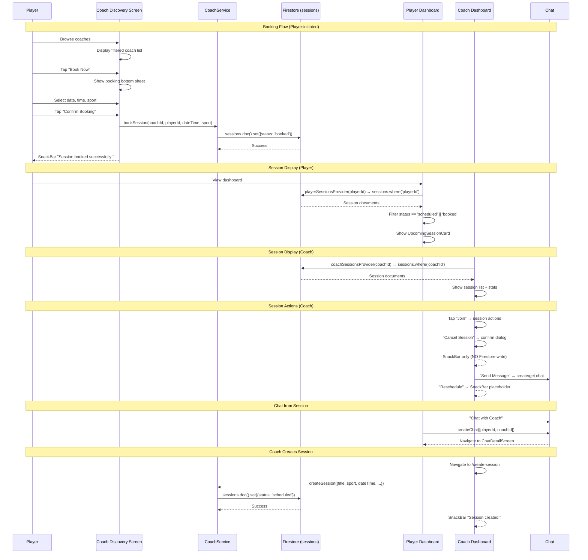
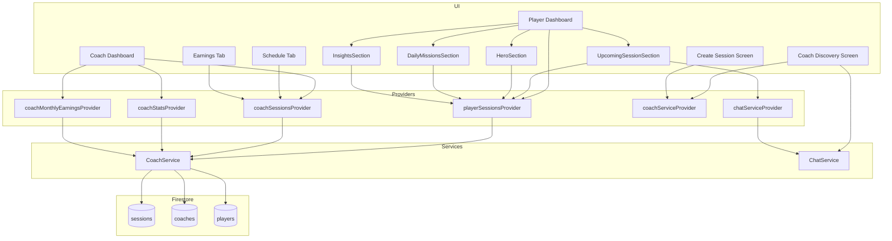

# SESSION ARCHITECTURE

> Complete audit of the Session / Booking module in SportsEco.
> Generated from actual codebase inspection — no assumptions, no future ideas.

---

## 1. Session Model

**There is NO dedicated `SessionModel` class.** Sessions are stored and read as raw `Map<String, dynamic>` from Firestore documents via `QuerySnapshot<Map<String, dynamic>>` and `DocumentSnapshot<Map<String, dynamic>>`.

Sessions are created inline in `CoachService` and consumed as untyped maps in UI widgets.

### Fields Written to Firestore

| Field | Type | Nullable | Written By |
|---|---|---|---|
| `sessionId` | `String` | No | `bookSession()`, `createSession()` |
| `coachId` | `String` | No | `bookSession()`, `createSession()` |
| `playerId` | `String` | No | `bookSession()`, `createSession()` |
| `sport` | `String` | No | `bookSession()`, `createSession()` |
| `dateTime` | `Timestamp` | No | `bookSession()`, `createSession()` |
| `status` | `String` | No | `bookSession()` → `'booked'`, `createSession()` → `'scheduled'` |
| `title` | `String` | No | `createSession()` only |
| `description` | `String` | Yes (default `''`) | `createSession()` only |
| `capacity` | `int` | No | `createSession()` only |
| `venue` | `String` | No | `createSession()` only |
| `price` | `double` | No | `createSession()` only |
| `isOnline` | `bool` | No | `createSession()` only |
| `createdAt` | `FieldValue.serverTimestamp()` | Server-set | Both methods |

### Two Distinct Write Schemas

**`bookSession()` — Player booking a coach** (simpler):
```dart
{
  'sessionId': auto-generated ID,
  'coachId': coachId,
  'playerId': playerId,
  'sport': sport,
  'dateTime': Timestamp,
  'status': 'booked',
  'createdAt': serverTimestamp,
}
```

**`createSession()` — Coach creating a session** (richer):
```dart
{
  'sessionId': auto-generated ID,
  'coachId': coachId,
  'playerId': playerId ?? coachId,  // defaults to coachId if no player
  'title': title,
  'sport': sport,
  'description': description,
  'dateTime': Timestamp,
  'capacity': capacity,
  'venue': venue,
  'price': price,
  'isOnline': isOnline,
  'status': 'scheduled',
  'createdAt': serverTimestamp,
}
```

### Fields Read in UI (but not always written by both paths)

| Field | Read By |
|---|---|
| `title` | `_UpcomingSessionCard`, `_MissionsContent` |
| `sport` | Multiple widgets |
| `dateTime` | All session displays |
| `status` | All session displays |
| `venue` | `_UpcomingSessionCard` |
| `price` | `_UpcomingSessionCard`, `_CoachDashboardContent` |
| `capacity` | `_UpcomingSessionCard` |
| `isOnline` | `_UpcomingSessionCard` |
| `coachId` | `UpcomingSessionSection` (for chat), `_MissionsContent` |
| `playerId` | `CoachDashboard`, `ScheduleTab`, `EarningsTab` |

---

## 2. Firestore Structure

### Collection: `sessions`

**Document structure:**
```
sessions/
  {auto-generated-id}/
    sessionId: string
    coachId: string          // FK → coaches/{coachId}
    playerId: string         // FK → players/{playerId}
    sport: string
    dateTime: timestamp
    status: string           // 'booked' | 'scheduled' | 'completed' | 'cancelled'
    title: string            // only from createSession()
    description: string      // only from createSession()
    capacity: number         // only from createSession()
    venue: string            // only from createSession()
    price: number            // only from createSession()
    isOnline: boolean        // only from createSession()
    createdAt: timestamp     // server-generated
```

**References:**
- `coachId` → `coaches/{coachId}` (read via `coachProvider`)
- `playerId` → `players/{playerId}` (read via `playerProvider`)

**Indexes (from `firestore.indexes.json`):**
| Fields | Order |
|---|---|
| `coachId` ASC, `dateTime` ASC | Compound index |

**Missing Index (code requires it but not declared):**
- `playerId` ASC, `dateTime` ASC — required by `getPlayerSessions()` which queries `.where('playerId', isEqualTo: playerId)`. No compound index declared for this. Firestore will still serve single-field queries, but sorting is done client-side.

**Firestore Rules (`firestore.rules:33-35`):**
```
match /sessions/{sessionId} {
  allow read, write: if request.auth != null;
}
```
Open read/write to any authenticated user — no role-based or ownership restrictions.

---

## 3. Files Touching Sessions

### Models
- **NONE** — No `SessionModel` exists. Sessions are raw maps throughout.

### Services
| File | Session Methods |
|---|---|
| `lib/services/coach_service.dart` | `bookSession()`, `createSession()`, `getCoachSessions()`, `getPlayerSessions()`, `getCoachStats()`, `getCoachMonthlyEarnings()` |

### Providers
| File | Session Providers |
|---|---|
| `lib/services/providers.dart` | `coachSessionsProvider`, `playerSessionsProvider`, `coachStatsProvider`, `coachMonthlyEarningsProvider` |

### Player Module
| File | Usage |
|---|---|
| `lib/features/player/presentation/dashboard/dashboard_page.dart` | Includes `UpcomingSessionSection` |
| `lib/features/player/presentation/dashboard/widgets/upcoming_session_section.dart` | Displays next upcoming session for player |
| `lib/features/player/presentation/dashboard/widgets/hero_section.dart` | Reads sessions for streak calc, next session countdown, training day count |
| `lib/features/player/presentation/dashboard/widgets/daily_missions_section.dart` | Reads sessions for "Attend Session" mission |
| `lib/features/player/presentation/dashboard/widgets/insights_section.dart` | Reads sessions for consistency score, weekly activity |
| `lib/features/player/presentation/dashboard/widgets/quick_actions_section.dart` | Has a "Sessions" quick action (route: `'sessions'`) |

### Coach Module
| File | Usage |
|---|---|
| `lib/features/coach/presentation/coach_dashboard.dart` | Displays upcoming sessions, session actions, session stats |
| `lib/features/coach/presentation/create_session_screen.dart` | Session creation form |
| `lib/features/home/presentation/schedule_tab.dart` | Full session schedule list for coach |
| `lib/features/home/presentation/earnings_tab.dart` | Session-based earnings display |
| `lib/features/home/presentation/students_tab.dart` | Mentions sessions in empty state text |

### Parent Module
| File | Usage |
|---|---|
| `lib/features/home/presentation/parent_dashboard.dart` | Has `_logSession()` method (logs metrics, NOT booking sessions) |

### Academy Module
| File | Usage |
|---|---|
| NONE | No session-specific code in academy module |

### Admin Module
| File | Usage |
|---|---|
| NONE | No session-specific code in admin module |

### Coach Discovery (Booking)
| File | Usage |
|---|---|
| `lib/features/home/presentation/coach_discovery_screen.dart` | "Book Now" bottom sheet calls `coachService.bookSession()` |

### Navigation
| File | Usage |
|---|---|
| `lib/core/routing/app_router.dart` | Route `/create-session` → `CreateSessionScreen` |

### Shell/Layout
| File | Usage |
|---|---|
| `lib/features/home/presentation/coach_shell.dart` | Includes `ScheduleTab` in coach nav |
| `lib/features/home/presentation/player_shell.dart` | Includes player dashboard (which has sessions) |
| `lib/features/home/presentation/parent_shell.dart` | No direct session UI |
| `lib/features/home/presentation/academy_shell.dart` | No session UI |
| `lib/features/home/presentation/admin_shell.dart` | No session UI |

---

## 4. Providers

### Session-Specific Providers

| Provider | Type | Source | Consumers |
|---|---|---|---|
| `coachSessionsProvider(coachId)` | `StreamProvider.family.autoDispose<QuerySnapshot>` | `CoachService.getCoachSessions()` | `CoachDashboard`, `ScheduleTab`, `EarningsTab` |
| `playerSessionsProvider(playerId)` | `StreamProvider.family.autoDispose<QuerySnapshot>` | `CoachService.getPlayerSessions()` | `UpcomingSessionSection`, `HeroSection`, `DailyMissionsSection`, `InsightsSection` |
| `coachStatsProvider(coachId)` | `FutureProvider.family.autoDispose<Map>` | `CoachService.getCoachStats()` | `CoachDashboard` |
| `coachMonthlyEarningsProvider(coachId)` | `FutureProvider.family.autoDispose<Map>` | `CoachService.getCoachMonthlyEarnings()` | `CoachDashboard` |

### Related Providers Used Alongside Sessions

| Provider | Type | Used For |
|---|---|---|
| `coachProvider(coachId)` | `StreamProvider.family` | Resolving coach name/avatar in session cards |
| `playerProvider(playerId)` | `StreamProvider.family` | Resolving player name in session cards |
| `coachServiceProvider` | `Provider<CoachService>` | Direct service access for `bookSession()` and `createSession()` |
| `chatServiceProvider` | `Provider<ChatService>` | Creating chat from session card |

---

## 5. Firebase Service Methods

All session-related service functions live in `lib/services/coach_service.dart`.

### READ
| Method | Signature | Firestore Query |
|---|---|---|
| `getCoachSessions` | `Stream<QuerySnapshot> getCoachSessions(String coachId)` | `sessions.where('coachId', isEqualTo: coachId)` |
| `getPlayerSessions` | `Stream<QuerySnapshot> getPlayerSessions(String playerId)` | `sessions.where('playerId', isEqualTo: playerId)` |
| `getCoachStats` | `Future<Map> getCoachStats(String coachId)` | `sessions.where('coachId', isEqualTo: coachId).get()` (one-shot) |
| `getCoachMonthlyEarnings` | `Future<Map> getCoachMonthlyEarnings(String coachId)` | `sessions.where('coachId', isEqualTo: coachId).get()` (one-shot) |

### CREATE
| Method | Signature | Firestore Write |
|---|---|---|
| `bookSession` | `Future<void> bookSession(String coachId, String playerId, DateTime dateTime, String sport)` | `sessions.doc().set({...})` — status: `'booked'` |
| `createSession` | `Future<void> createSession({coachId, title, sport, description, dateTime, capacity, venue, price, isOnline, playerId})` | `sessions.doc().set({...})` — status: `'scheduled'` |

### UPDATE
- **NONE** — No `updateSession()` method exists.

### DELETE
- **NONE** — No `deleteSession()` method exists.

### COMPLETE
- **NONE** — No `completeSession()` method exists. Status is never changed to `'completed'` in code.

### CANCEL
- **NONE** — No `cancelSession()` method exists. Status is never changed to `'cancelled'` in code. The coach dashboard shows a cancel confirmation dialog, but the "Yes, Cancel" action only shows a snackbar — it does NOT update Firestore.

### RESCHEDULE
- **NONE** — No reschedule method exists.

### ATTENDANCE
- **NONE** — No attendance tracking exists.

### PAYMENT
- **NONE** — No payment processing for sessions. The `price` field is stored but never processed.

---

## 6. Booking Flow

### Current Implemented Flow

```
Player
  ↓
Coach Discovery Screen (lib/features/home/presentation/coach_discovery_screen.dart)
  - Player browses coaches filtered by sport/location/rating
  - Taps "Book Now" on a coach card
  ↓
Booking Bottom Sheet (coach_discovery_screen.dart:398-561)
  - Player selects: Date, Time, Sport
  - Taps "Confirm Booking"
  ↓
CoachService.bookSession() (lib/services/coach_service.dart:48-58)
  - Writes to Firestore: sessions collection
  - Status: 'booked'
  - Fields: sessionId, coachId, playerId, sport, dateTime, status, createdAt
  ↓
Firestore (sessions collection)
  ↓
Player Dashboard — UpcomingSessionSection
  - Reads via playerSessionsProvider(playerId)
  - Filters: status == 'scheduled' || status == 'booked'
  - Shows next upcoming session with countdown
  ↓
Player Dashboard — HeroSection
  - Reads via playerSessionsProvider(playerId)
  - Calculates: streak, training day count, next session countdown
  ↓
Player Dashboard — DailyMissionsSection
  - Reads sessions for "Attend Session" mission
  ↓
Player Dashboard — InsightsSection
  - Reads sessions for consistency score, weekly activity
  ↓
Coach Dashboard (lib/features/coach/presentation/coach_dashboard.dart)
  - Reads via coachSessionsProvider(coachId)
  - Shows: upcoming sessions list, session stats, earnings
  - "Join" button → session actions bottom sheet
  ↓
Session Actions Bottom Sheet (coach_dashboard.dart:505-551)
  - "Start Video Session" → snackbar (not implemented)
  - "Send Message" → navigates to /chat
  - "Reschedule" → snackbar (not implemented)
  - "Cancel Session" → confirmation dialog → snackbar (NO Firestore write)
  ↓
Schedule Tab (lib/features/home/presentation/schedule_tab.dart)
  - Full session list for coach, sorted by dateTime
  - Shows status labels: Completed, Cancelled, Missed, Upcoming
  - No interactive actions
  ↓
Earnings Tab (lib/features/home/presentation/earnings_tab.dart)
  - Shows session count, completed count, estimated earnings
  - Session history list with status
```

### Coach-Initiated Flow

```
Coach Dashboard
  ↓
"Create Session" button (or Quick Action)
  ↓
Create Session Screen (lib/features/coach/presentation/create_session_screen.dart)
  - Form: Title, Sport, Description, Date, Time, Capacity, Price, Venue, Online toggle
  - Calls CoachService.createSession()
  ↓
Firestore (sessions collection)
  - Status: 'scheduled'
  - Includes all rich fields (title, capacity, venue, price, isOnline)
```

### What Does NOT Exist
- No player acceptance/rejection flow
- No session confirmation from coach side
- No payment processing at booking time
- No session completion workflow
- No attendance marking
- No session rescheduling
- No cancellation that writes to Firestore
- No session history screen (separate from earnings)
- No session detail screen
- No notification system for sessions
- No parent visibility into player sessions (no session reads in parent module)

---

## 7. Session Lifecycle

### States Actually Used in Code

| State | Written By | Read/Checked By |
|---|---|---|
| `'booked'` | `CoachService.bookSession()` | `UpcomingSessionSection` (filter), `HeroSection` (filter), `DailyMissionsSection` (check), `ScheduleTab` (default label) |
| `'scheduled'` | `CoachService.createSession()` | `UpcomingSessionSection` (filter), `HeroSection` (filter), `DailyMissionsSection` (check) |
| `'completed'` | **NEVER written in code** | `CoachService.getCoachStats()` (count), `ScheduleTab` (status label), `EarningsTab` (status label/filter), `HeroSection` (streak calc), `DailyMissionsSection` (mission check), `InsightsSection` (consistency calc) |
| `'cancelled'` | **NEVER written in code** | `ScheduleTab` (status label), `EarningsTab` (status label) |

### Derived States in UI (not Firestore)

| Label | Condition | Where |
|---|---|---|
| `'Upcoming'` | `status != 'completed' && status != 'cancelled' && !isPast` | `ScheduleTab:107` |
| `'Missed'` | `status != 'completed' && status != 'cancelled' && isPast` | `ScheduleTab:108` |
| `'Confirmed'` | Always shown for upcoming sessions | `UpcomingSessionSection:146` (hardcoded) |
| `'Started'` | Countdown is negative | `UpcomingSessionSection:317` |

### State Transition Map

```
[Created via bookSession()]     [Created via createSession()]
       ↓                                ↓
    'booked'                       'scheduled'
       ↓                                ↓
    (NO CODE transitions to 'completed' or 'cancelled')
```

---

## 8. Navigation

### Player Access
| Path | Screen | Session Functionality |
|---|---|---|
| `/home` → `PlayerShell` → `PlayerDashboard` | `DashboardPage` | Upcoming session card, streak, training day, countdown, quick actions |
| `/home` → `PlayerShell` → `CoachDiscoveryScreen` | `CoachDiscoveryScreen` | "Book Now" bottom sheet for booking sessions |
| `/home` → `PlayerShell` → `PerformanceTab` | `PerformanceTab` | Logs metrics (not booking sessions) |

### Coach Access
| Path | Screen | Session Functionality |
|---|---|---|
| `/home` → `CoachShell` → `CoachDashboard` | `CoachDashboard` | Session list, stats, session actions (join/cancel) |
| `/home` → `CoachShell` → `ScheduleTab` | `ScheduleTab` | Full session schedule |
| `/home` → `CoachShell` → `EarningsTab` | `EarningsTab` | Session-based earnings |
| `/home` → `CoachShell` → `StudentsTab` | `StudentsTab` | Student list (derived from player records, not sessions) |
| `/create-session` | `CreateSessionScreen` | Create new session form |

### Parent Access
| Path | Screen | Session Functionality |
|---|---|---|
| `/home` → `ParentShell` → `ParentDashboard` | `ParentDashboard` | `_logSession()` logs metrics only — NOT booking sessions |
| `/home` → `ParentShell` → `CoachDiscoveryScreen` | `CoachDiscoveryScreen` | Can book sessions (same as player) |

### Academy Access
| Path | Screen | Session Functionality |
|---|---|---|
| NONE | — | No session-specific screens or functionality |

### Admin Access
| Path | Screen | Session Functionality |
|---|---|---|
| NONE | — | No session-specific screens or functionality |

---

## 9. UI Screens

| Screen | File | Purpose | Provider(s) | Service | Firestore Collection |
|---|---|---|---|---|---|
| `UpcomingSessionSection` | `widgets/upcoming_session_section.dart` | Shows next upcoming session card on player dashboard | `playerSessionsProvider`, `chatServiceProvider` | `CoachService.getPlayerSessions()` | `sessions` |
| `_UpcomingSessionCard` | (same file) | Session card with countdown, sport, venue, price, navigate/chat buttons | — | — | — |
| `HeroSection` | `widgets/hero_section.dart` | Player greeting with streak, training day, XP, next session countdown | `playerSessionsProvider`, `playerProvider` | `CoachService.getPlayerSessions()` | `sessions` |
| `DailyMissionsSection` | `widgets/daily_missions_section.dart` | Daily missions including "Attend Session" | `playerSessionsProvider`, `playerProvider` | `CoachService.getPlayerSessions()` | `sessions` |
| `InsightsSection` | `widgets/insights_section.dart` | AI insights including consistency score from sessions | `playerSessionsProvider`, `playerProvider` | `CoachService.getPlayerSessions()` | `sessions` |
| `QuickActionsSection` | `widgets/quick_actions_section.dart` | Quick action grid including "Sessions" button (route: `'sessions'`) | — | — | — |
| `CoachDashboard` | `coach/presentation/coach_dashboard.dart` | Coach home with session list, stats, session actions | `coachSessionsProvider`, `coachStatsProvider`, `coachMonthlyEarningsProvider` | `CoachService.getCoachSessions()`, `getCoachStats()`, `getCoachMonthlyEarnings()` | `sessions` |
| `CreateSessionScreen` | `coach/presentation/create_session_screen.dart` | Form to create a new session | `coachServiceProvider` | `CoachService.createSession()` | `sessions` |
| `ScheduleTab` | `home/presentation/schedule_tab.dart` | Full chronological session list for coach | `coachSessionsProvider`, `playerProvider` | `CoachService.getCoachSessions()` | `sessions` |
| `EarningsTab` | `home/presentation/earnings_tab.dart` | Session-based earnings display for coach | `coachSessionsProvider`, `coachProvider` | `CoachService.getCoachSessions()` | `sessions` |
| `CoachDiscoveryScreen` | `home/presentation/coach_discovery_screen.dart` | Browse coaches with "Book Now" bottom sheet | `coachesStreamProvider`, `coachServiceProvider` | `CoachService.bookSession()` | `sessions`, `coaches` |

---

## 10. Missing Implementations

### Incomplete Features (evidence from code)

1. **Cancel Session does NOT update Firestore** (`coach_dashboard.dart:575-579`)
   - Shows confirmation dialog
   - On "Yes, Cancel" → only shows `SnackBar('Session cancelled')`
   - No Firestore write call — status remains unchanged

2. **Reschedule is a placeholder** (`coach_dashboard.dart:535-539`)
   - Shows `SnackBar('Rescheduling coming soon')`

3. **Video Session is a placeholder** (`coach_dashboard.dart:525-529`)
   - Shows `SnackBar('Video session feature coming soon')`

4. **Navigate button is a placeholder** (`upcoming_session_section.dart:242-249`)
   - Shows `SnackBar('Navigation will be available soon')`

5. **"Start Training" button does not create/update sessions** (`hero_section.dart:431-438`)
   - Shows `SnackBar('Training session started!...')`
   - No Firestore interaction

6. **Quick Actions "Sessions" route is dead** (`quick_actions_section.dart:58-59`)
   - Route is `'sessions'` — not a valid GoRouter path (no `/` prefix)
   - Navigates via `context.go('sessions')` — will likely fail or go nowhere

7. **No session detail screen** — Sessions are only displayed as cards, never as a full detail view

8. **No session history screen** — Past sessions only appear in `EarningsTab` for coaches

9. **`_logSession()` in `ParentDashboard` is misnamed** (`parent_dashboard.dart:37-98`)
   - The method name suggests session booking but actually logs player metrics
   - It writes to `playerMetrics`, not `sessions`

10. **No `SessionModel`** — All session data flows as untyped `Map<String, dynamic>`

11. **No Firestore writes for status transitions** — `'completed'` and `'cancelled'` are never written anywhere in the codebase

---

## 11. Dead Code

### Unused References

1. **`performance_tab.dart:70`** — Button labeled `'Log New Session'` but actually logs a performance metric, not a booking session. The label is misleading but the function logs to `playerMetrics`.

2. **`quick_actions_section.dart:58-59`** — Route `'sessions'` is not a registered GoRouter route. The route `/create-session` exists but this doesn't reference it.

3. **`_confirmCancelSession` in `coach_dashboard.dart:562-586`** — Method exists but its Firestore write is missing. The snackbar-only implementation makes it dead in terms of functionality.

4. **Two `bookSession` schemas** — `bookSession()` creates documents with only 7 fields, while `createSession()` creates documents with 12 fields. Both write to the same `sessions` collection. This means:
   - Sessions booked by players are missing: `title`, `description`, `capacity`, `venue`, `price`, `isOnline`
   - Sessions created by coaches are missing nothing from the read schema
   - UI reads fields (`title`, `venue`, `price`, `capacity`, `isOnline`) that will be `null` for player-booked sessions

### No Duplicate Files
There are no duplicate service files, duplicate providers, or duplicate widgets for sessions.

---

## 12. Sequence Diagram



---

## 13. Architecture Diagram



---

## 14. Completion Assessment

| Module | % | Justification |
|---|---|---|
| **Session Model** | 15% | No `SessionModel` class exists. Sessions are raw maps. Two different write schemas create inconsistent documents. |
| **Booking** | 50% | Player-to-coach booking works via `bookSession()` with date/time/sport. Coach-initiated session creation works via `createSession()`. Missing: player capacity checks, slot conflict detection, booking confirmation flow. |
| **Scheduling** | 20% | Sessions are stored with `dateTime` and displayed in lists sorted by time. Missing: calendar view, recurring sessions, time slot management, availability, timezone handling. |
| **Cancellation** | 5% | UI has a cancel dialog in coach dashboard but NO Firestore write. Status is never updated to `'cancelled'`. |
| **Completion** | 2% | Status `'completed'` is read in stats/earnings calculations but NEVER written anywhere in code. No completion workflow exists. |
| **Attendance** | 0% | No attendance tracking, check-in, or presence system. |
| **History** | 15% | `EarningsTab` shows past sessions with status. `ScheduleTab` shows all sessions. No dedicated session history screen. No filtering/pagination. |
| **Notifications** | 0% | No push notifications, in-app notifications, or reminders for sessions. |
| **Payments** | 5% | `price` field is stored but never processed. No payment gateway integration. No payment records. No refund flow. |
| **Venue Integration** | 5% | `venue` field is a free-text string from `createSession()`. `VenueModel` and `VenueService` exist but are NOT connected to session booking. No venue selection in booking flow. |
| **Coach Integration** | 40% | Coach can create sessions, view schedule, see stats. Session list shows player name via `playerProvider`. Missing: coach availability, coach acceptance/rejection, coach session notes. |
| **Player Integration** | 35% | Player can book a coach, see upcoming sessions, view countdown. Missing: player session history, session detail view, player cancellation, session rating/review. |
| **Parent Integration** | 5% | Parent has `CoachDiscoveryScreen` for booking but no visibility into player's sessions, no session notifications for parents. |
| **Academy Integration** | 0% | No session-related code in the academy module. |
| **Overall Session Module** | 18% | Core booking and basic display work. Session lifecycle is incomplete — no status transitions, no completion, no cancellation, no attendance, no payments, no notifications. The module is functional for creating and viewing sessions but lacks almost all operational workflows. |

---

*Report generated from codebase inspection of 118 Dart files across the SportsEco Flutter project. All findings are backed by actual code locations.*
